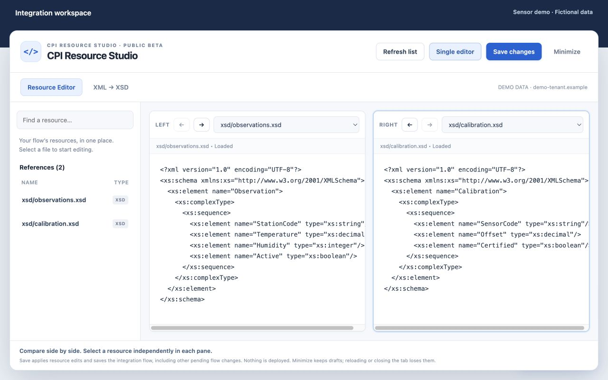
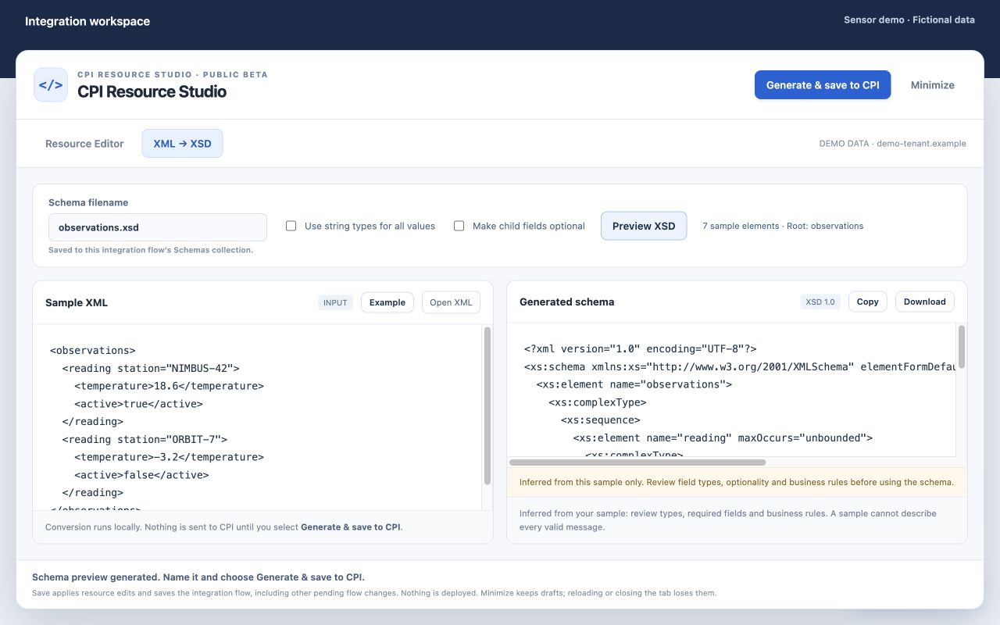

# CPI Resource Studio

An independent Chrome extension for SAP Cloud Integration. Read, edit and compare flow resources in the tenant page, and generate XSD resources from sample XML.

**Version 0.5.1 · Public beta · Chrome Web Store review pending**



## What it does

- Browse local XSD, WSDL, Groovy, JavaScript, XML and XSL/XSLT resources.
- Navigate resources without repeatedly closing native editors.
- Start with one editor; open a second pane for side-by-side comparison.
- Save through CPI's existing signed-in interface and show persistent success/error messages.
- Convert XML to XSD locally, choose a filename, save it to the current flow and refresh the resource list.

Side-by-side comparison is not a highlighted diff. Full XML-against-XSD validation and XSD-to-XML generation are not included.

## Install manually

1. Download the ZIP from this repository's **Releases**, or download the repository source ZIP.
2. Extract it to a permanent folder. Open `chrome://extensions` and enable **Developer mode**.
3. Select **Load unpacked**. For a release ZIP, select its extracted root. For the repository source, select the `extension/` folder.
4. Disable older CPI Resource Collection/Navigator builds to avoid duplicate panels, then refresh CPI after saving native drafts.
5. Pin **CPI Resource Studio**. Open a signed-in iFlow, click the extension icon, then **Open workspace**.

The extension activates only on the tab you select. After a full refresh, activate it again. Managed browsers may require administrator approval. This repository does not bypass organization policies.

## XML → XSD

Paste XML or select **Example**, choose a unique filename, preview and select **Generate & save to CPI**. The generated schema appears in the resource editor after CPI accepts it. Existing filenames are rejected rather than overwritten.



The screenshots and [sample XML](samples/observations.xml) contain fictional sensor data only.

## Save behavior

Save also persists other pending flow changes, just as native CPI Save does. Nothing is deployed. Resource updates are sequential, not transactional. Earlier resources may already be staged when a later operation fails. Do not operate native CPI controls while the extension is working. Drafts are held in memory; refresh/close loses them. There is no draft recovery.

## Compatibility

Chrome 111+ and supported desktop English SAP Cloud Integration designer pages over HTTPS. There is no hard-coded tenant allowlist. Compatibility still depends on SAPUI5/Ace controls, routing and permissions. Other tenants, localized/legacy designers and future SAP changes require further testing. The editing/upload core was live-verified on one copied flow; the public toolbar activation has automated simulated-API coverage, not a universal compatibility certification.

See the [user guide](docs/USER-GUIDE.md) for details and limitations.

## Privacy

Permissions: `activeTab` and `scripting`. No persistent host access, telemetry, external AI service, remote conversion service or publisher backend is bundled. Conversion runs locally; user-requested saves send resources to the current SAP tenant. Copy/Download/Open use the clipboard and local files. Code executes in the tenant's page environment to interact with its native editor, so it is not isolated from that page's scripts.

[Privacy policy](https://cpi-resource-studio-privacy.shubhamsrivast244635.chatgpt.site) · [Packaged policy](extension/privacy.html)

## Development

Node.js 18+ and Python 3 are used for development only. The extension itself has no npm/runtime dependencies.

```sh
npm ci
npm test
npm run package
```

Packaging creates `dist/cpi-resource-studio-v0.5.1.zip` and a SHA-256 checksum. Automated checks cover converter edge cases, popup access gating and simulated CPI discovery/edit/save/upload behavior. Live tenant checks are documented separately; automated mocks do not certify every tenant.

## Feedback

Open a GitHub issue or email **shubhamsrivastav.904@gmail.com**. Include Chrome/extension versions, anonymized environment details, steps and exact error text. Never post credentials, tenant URLs, confidential schemas or customer payloads. Please use fictional examples.

SAP and SAP Integration Suite are trademarks of SAP SE. This project is independent and is not affiliated with or endorsed by SAP.

## License

[MIT](LICENSE). Third-party trademarks remain with their owners. The XML parser dependency is used only in development tests and is not bundled into the extension.
